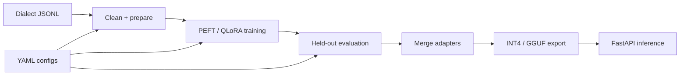

<div align="center">

# Lahja | لهجة
### Gulf Arabic dialect LLM engineering

**Data preparation → QLoRA fine-tuning → Evaluation → Quantization → API serving**

[](https://github.com/FaizanAKhan786/lahja/actions/workflows/ci.yml)
[](LICENSE)


[Quick start](#quick-start) · [Architecture](#architecture) · [Training](#training-and-evaluation) · [Source](https://github.com/FaizanAKhan786/lahja)

</div>

## Why Lahja?

Standard Arabic and Gulf dialects differ in vocabulary, morphology and conversational style. Lahja provides a reproducible **model adaptation pipeline** targeting dialects used in Qatar, the UAE, Saudi Arabia and Kuwait. The project ships example data and separate configurations for smoke tests and more demanding training runs.

| Component | In this repository |
| --- | --- |
| Data | Instruction dataset preparation and filtering |
| Training | Transformers, PEFT / LoRA, optional QLoRA 4-bit loading |
| Evaluation | Dialect metrics, held-out perplexity and optional judge-based checks |
| Packaging | Adapter merge, quantization export and GGUF helper script |
| Inference | FastAPI `/generate`, `/health`, `/info`; optional streaming |
| Development | Mock backend, pytest and CI |

## Architecture



## Quick start

**Python 3.10+** is required. The smallest path is a deterministic mock server, useful for checking request/response behavior without a GPU or model download.

```bash
git clone https://github.com/FaizanAKhan786/lahja.git
cd lahja
python -m venv .venv
source .venv/bin/activate   # Windows: .venv\Scripts\activate
pip install -e ".[dev]"
LAHJA_MOCK_MODEL=1 uvicorn lahja.serve.api:app --port 8000
```

Try the local API in another terminal:

```bash
curl -X POST http://localhost:8000/generate \
  -H "Content-Type: application/json" \
  -d '{"prompt":"شلونك؟","max_new_tokens":64}'
```

This mock **does not generate learned dialect responses**. For real inference, set `LAHJA_MODEL_DIR` to a merged Transformers model or `LAHJA_GGUF_PATH` to a compatible local GGUF file and install the appropriate extras.

## Training and evaluation

```bash
pip install -e ".[train,dev]"
python -m lahja.data.prepare --config configs/sample.yaml
python -m lahja.train.qlora --config configs/sample.yaml --max-steps 5
python -m lahja.eval.evaluate --config configs/sample.yaml
pytest -q
```

The sample configuration references `Qwen/Qwen2.5-0.5B-Instruct` and will require model download unless cached. Larger QLoRA runs require substantially more GPU memory. Use [`configs/training.yaml`](configs/training.yaml) for non-sample experiments and [`scripts/quantize_gguf.sh`](scripts/quantize_gguf.sh) for GGUF conversion.

**Model scores are not published here as verified benchmark results.** Judge quality with your own held-out test set before treating the model as suitable for real-world deployment.

## Structure

| Path | Purpose |
| --- | --- |
| [`src/lahja/data/`](src/lahja/data/) | Data cleaning and formatting |
| [`src/lahja/train/`](src/lahja/train/) | Fine-tuning and adapter utilities |
| [`src/lahja/eval/`](src/lahja/eval/) | Evaluation |
| [`src/lahja/serve/`](src/lahja/serve/) | API and inference backends |
| [`configs/`](configs/) | Sample, training and serving settings |
| [`tests/`](tests/) | Automated checks |

## Design boundaries

Offline inference is possible **after** model files and dependencies are provisioned. The included small sample dataset is for testing the pipeline, not proof of a domain-specialized production model.

[Issues](https://github.com/FaizanAKhan786/lahja/issues) · [GitHub profile](https://github.com/FaizanAKhan786)
